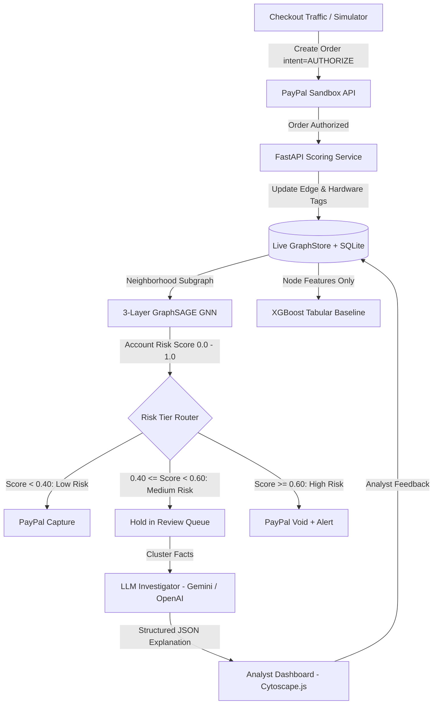

# RingBreaker

**Network-aware payment fraud ring detection on PayPal Sandbox using Graph Neural Networks and LLM investigation.**

Built for the **PayPal AI Hackathon** (Devpost). Hard deadline: Nov 12, 2026.

[](LICENSE)
[](requirements.txt)
[](tests/)
[](app/paypal_client.py)

---

## What is RingBreaker?

Traditional checkout fraud checks score transactions **one row at a time**. When an organized crime ring opens dozens of burner accounts to loop stolen money, funnel funds into a cash-out mule, or coordinate payments from a shared hardware device farm, every individual transaction looks small, ordinary, and clean — single-payment checks pass them every time.

**RingBreaker looks at the entire transaction graph.** It captures payments in an `AUTHORIZE` state first, attaches transactions to a live NetworkX transaction graph, and runs a **Graph Neural Network (GraphSAGE, 3-layer)** to score accounts based on multi-hop neighborhood topology and shared hardware fingerprints.

| Risk Tier | Score | Action |
| :--- | :--- | :--- |
| **Low** | < 0.40 | Auto-captured via PayPal Orders Capture |
| **Medium** | 0.40 – 0.60 | Held uncaptured in analyst review queue with LLM explanation |
| **High** | ≥ 0.60 | Authorization immediately voided via PayPal Orders Void |

---

## Architecture



### Components

| Component | File | Purpose |
| :--- | :--- | :--- |
| Checkout Simulator | `app/simulator.py` | Emulates normal traffic and 3 labeled ring attack types |
| PayPal Client | `app/paypal_client.py` | OAuth2, Orders v2 authorize / capture / void / webhook |
| Graph Store | `app/graph_store.py` | Live NetworkX MultiDiGraph + SQLite audit trail |
| GNN Detector | `ml/train_gnn.py` | 3-layer GraphSAGE with class-weighted loss |
| XGBoost Baseline | `ml/train_baseline.py` | Tabular classifier on identical 15 node features |
| LLM Investigator | `app/investigator.py` | Gemini / OpenAI plain-language explanation, Pydantic-validated |
| Analyst Dashboard | `app/static/dashboard.html` | Cytoscape.js graph, live payments feed, threshold slider |
| Landing Page | `app/static/index.html` | Editorial page with live Cytoscape mini-graph hero |

---

## Honest Benchmark Results

Evaluated on held-out test data: **1,160 accounts** (183 fraud, 977 legitimate; 15.78% fraud rate) with ring-level disjoint splits and no data leakage. All numbers below are sourced directly from `ml/artifacts/metrics.json`.

### Equal Operating Point — 2% FPR (Equal Comparison)

| Metric | GNN (GraphSAGE) | Strong Tabular Baseline | Delta |
| :--- | :---: | :---: | :---: |
| **Recall** | **98.4%** | 71.0% | **+27.4pp** |
| **Precision** | 90.5% | 87.8% | -7.3pp |
| **F1** | 94.2% | 78.6% | +15.7pp |
| **FPR** | 1.94% | 1.84% | ≈ same |
| Test positives | 183 | 183 | — |

### Multi-Seed Stability (5 Seeds: 42–46)

| Metric | GNN Mean ± Std | Strong Baseline Mean ± Std |
| :--- | :--- | :--- |
| **PR-AUC** | **0.9913 ± 0.0048** | 0.9342 ± 0.0192 |
| **ROC-AUC** | **0.9977 ± 0.0012** | 0.9854 ± 0.0041 |

### Three-Tier Outcomes at Calibrated Thresholds (Test Set)

| Outcome | GNN | Strong Baseline | Plain Baseline |
| :--- | :--- | :--- | :--- |
| Fraud auto-voided (**recall**) | **91.8%** (168/183) | 76.0% (139/183) | 25.1% (46/183) |
| Fraud sent to review | 3.3% (6/183) | 20.2% (37/183) | 72.7% (133/183) |
| Fraud leaked through (auto-captured) | 4.9% (9/183) | 3.8% (7/183) | 2.2% (4/183) |
| Legit auto-captured (**specificity**) | **99.4%** (971/977) | 88.0% (860/977) | 82.2% (803/977) |
| Legit sent to review (burden) | 0.2% (2/977) | 9.5% (93/977) | 17.2% (168/977) |
| Legit incorrectly voided (harm) | 0.4% (4/977) | 2.5% (24/977) | 0.6% (6/977) |

> **Key takeaway:** GNN captures ring structure through multi-hop message passing, achieving 98.4% recall at 2% FPR versus 71.0% for a strong graph-aggregate tabular baseline at the same FPR.

### What is real and what is simulated?

| Claim | Status |
| :--- | :--- |
| Graph Neural Network model | **Real** — PyTorch Geometric GraphSAGE, trained on synthetic graph |
| XGBoost baseline | **Real** — trained independently, honest benchmark |
| PayPal Orders v2 (authorize / capture / void) | **Real** — sandbox API calls |
| PayPal webhook verification | **Real** — HMAC-SHA256 signature check |
| Transaction data | **Synthetic** — generated by `ml/build_graph.py` |
| Device / IP fingerprints | **Simulated** — deterministic metadata attached by simulator |
| Money movement | **Simulated** — sandbox credentials required; no real money |
| LLM explanations | **Real** API calls when `GEMINI_API_KEY` or `OPENAI_API_KEY` set; deterministic fallback otherwise |

---

## Quickstart

### Prerequisites

- Python 3.11 or 3.12
- Git

### 1. Clone and set up

```bash
git clone https://github.com/your-username/ringbreaker.git
cd ringbreaker

python -m venv .venv

# Windows (PowerShell):
.\.venv\Scripts\Activate.ps1
# Linux / macOS:
source .venv/bin/activate

# CPU-only PyTorch (smaller download):
pip install torch>=2.2.0 --index-url https://download.pytorch.org/whl/cpu
pip install torch_geometric>=2.5.0
pip install -r requirements.txt
```

### 2. Configure environment

```bash
cp .env.example .env
```

Edit `.env` — all keys are optional; RingBreaker runs in simulated demo mode without them:

```ini
# PayPal Developer Sandbox (developer.paypal.com)
PAYPAL_CLIENT_ID=your_sandbox_client_id
PAYPAL_CLIENT_SECRET=your_sandbox_secret

# LLM Investigator
LLM_PROVIDER=gemini
GEMINI_API_KEY=your_gemini_api_key

# Admin API token
ADMIN_TOKEN=rb_secret_admin_token_change_me
```

### 3. Train models (or use pre-trained weights)

Pre-trained weights are included in `ml/artifacts/`. To reproduce from scratch:

```bash
python ml/build_graph.py       # Build synthetic graph (5,904 nodes, ~50k edges)
python ml/train_gnn.py         # Train GraphSAGE (Epoch 84, PR-AUC 0.9882)
python ml/train_baseline.py    # Train XGBoost baseline
python ml/evaluate.py          # Export ml/artifacts/metrics.json
```

### 4. Run tests

```bash
python -m pytest tests/ -q
# Expected: 30 passed, 2 skipped
```

### 5. Launch

```bash
python -m uvicorn app.main:app --reload --port 8000
```

## Limitations

RingBreaker will sometimes flag legitimate activity (false positives) and miss some fraud (false negatives). To mitigate false-positive harm, borderline payments are never automatically cancelled — they route to human review.

The models were trained on a **synthetic** transaction graph with injected ground-truth rings. The model's representation of "suspicious" reflects those synthetic patterns and would require retraining on a merchant's real historical ledger before production use.

Device and IP identifiers in the demo are simulated metadata attached by the checkout simulator. The PayPal sandbox does not emit hardware fingerprints. No real money is charged or settled.

---

## AI Tools Disclosure

In accordance with PayPal AI Hackathon submission rules:

| Tool | Role |
| :--- | :--- |
| **PyTorch Geometric (GraphSAGE)** | 3-layer inductive node classifier aggregating multi-hop neighbor features along directed transaction edges |
| **XGBoost** | Gradient-boosted decision trees serving as the tabular baseline on identical non-graph features |
| **Gemini 1.5 Flash / OpenAI GPT-4o-mini** | Plain-language investigator translating graph topology facts into Pydantic-validated JSON explanations |
| **Antigravity (Google DeepMind)** | Pair programming and software engineering assistant during hackathon development |

---

## Project Structure

```
ringbreaker/
├── app/
│   ├── graph_store.py       # NetworkX + SQLite live graph
│   ├── investigator.py      # LLM investigator (Gemini / OpenAI)
│   ├── main.py              # FastAPI application
│   ├── paypal_client.py     # PayPal Orders v2 client
│   ├── scoring.py           # GNN live scorer + risk tier router
│   ├── simulator.py         # Traffic & fraud ring simulator
│   └── static/              # HTML frontend (dashboard, landing, 404)
├── data/
│   ├── features.csv         # 15 extracted node features
│   └── labels.csv           # Ground-truth fraud labels (training only)
├── docs/
│   ├── ARCHITECTURE.md      # System design detail
│   ├── PAYPAL_SETUP.md      # PayPal sandbox credential guide
│   ├── PRD.md               # Product requirements
│   ├── SUBMISSION.md        # Devpost submission pack
│   ├── design/SKILL.md      # Design system (colors, typography, motion)
│   └── evidence/            # Benchmark outputs and audit logs
├── ml/
│   ├── artifacts/           # Trained weights + metrics.json
│   ├── build_graph.py       # Synthetic graph generator
│   ├── evaluate.py          # Evaluation + metrics export
│   ├── features.py          # Feature extraction (15 features)
│   ├── train_baseline.py    # XGBoost baseline trainer
│   └── train_gnn.py         # GraphSAGE trainer (Epoch 84)
├── scripts/                 # Utility scripts (bench, verify, demo)
├── tests/                   # 30 unit tests (pytest)
├── .env.example             # Environment variable template
├── LICENSE                  # MIT
└── requirements.txt         # Python dependencies
```

---

## License

[MIT License](LICENSE) — Copyright (c) 2026 Ridima Jain
