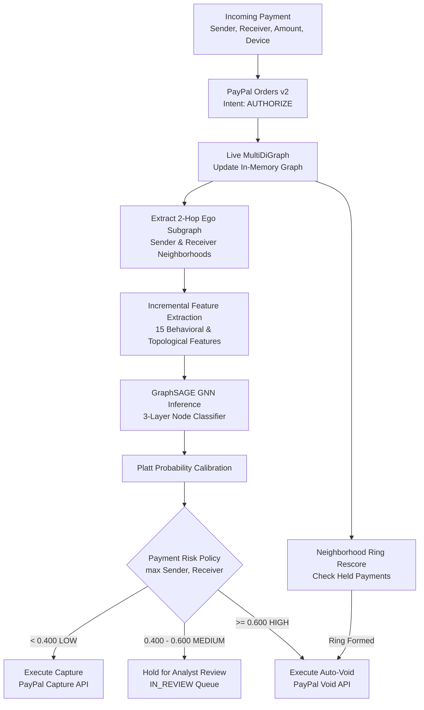

# RingBreaker Architecture & Risk Policy Specification

## 1. System Overview

RingBreaker is an agentic fraud prevention engine designed for PayPal payment networks to detect coordinated fraud rings (circular layering, smurfed fan-in mule funnels, and synthetic identity device farms).

Unlike traditional tabular risk models that analyze transactions in isolation, RingBreaker performs real-time graph inference using a 3-layer GraphSAGE Graph Neural Network (GNN) over 2-hop ego subgraphs.

---

## 2. Payment-Level Risk Policy (Directive 3.3)

In peer-to-peer and merchant payments, risk is inherently bilateral: a fraudulent cash-out transaction involves both an compromised sender (or synthetic account) and an aggregator receiver (or mule hub).

### 2.1 The Bilateral Max Policy
The transaction risk score $R_{\text{tx}}$ is defined as:
$$R_{\text{tx}} = \max\left(R_{\text{sender}}, R_{\text{receiver}}\right)$$

Where:
- $R_{\text{sender}}$ is the Platt-calibrated GNN fraud probability for the sender account over its 2-hop ego subgraph.
- $R_{\text{receiver}}$ is the Platt-calibrated GNN fraud probability for the receiver account over its 2-hop ego subgraph.

### 2.2 Cold Start Identification (Directive 3.2, M2)
- Any account with $\le 1$ prior transaction in the graph is explicitly marked `cold_start = true`.
- Cold-start status is persisted in the database, displayed in the investigator dashboard, and logged in the audit trail.
- Cold-start accounts are evaluated with their initial ego neighborhood without silently defaulting to zero risk.

### 2.3 Three-Tier Calibrated Routing Policy (Directive 2.5, C8)
Thresholds are dynamically calibrated on validation data to meet operational SLAs:

| Risk Tier | Score Range | Operational SLA / Target | Automated Action | PayPal API Execution |
| :--- | :--- | :--- | :--- | :--- |
| **LOW** | $R_{\text{tx}} < 0.400$ | Expected fraud leakage $\le 1.5\%$ | Auto-Capture | `POST /v2/payments/authorizations/{id}/capture` |
| **MEDIUM** | $0.400 \le R_{\text{tx}} < 0.600$ | Borderline / Uncertain patterns | Hold for Review | Held in `IN_REVIEW` queue for investigator decision |
| **HIGH** | $R_{\text{tx}} \ge 0.600$ | Minimum precision $\ge 85.0\%$ | Auto-Void | `POST /v2/payments/authorizations/{id}/void` |

---

## 3. Dynamic Re-Scoring of Held Payments (Directive 3.4)

When a payment is placed in `IN_REVIEW`, its funds remain safely authorized but uncaptured.

If subsequent transactions complete a closed topology (e.g. closing an $A \to B \to C \to A$ cycle or dumping a mule hub to an unverified off-ramp):
1. The new transaction triggers an incremental neighborhood re-score of all active `IN_REVIEW` payments within 2 topological hops.
2. If the updated risk score crosses $R \ge 0.600$ (`threshold_high`):
   - The authorization is automatically voided (`paypal_client.void_authorization`).
   - The payment status updates to `VOIDED` with action `VOID_ON_RING_FORMATION`.
   - An event is recorded in `audit_log` documenting the ring closure evidence.

---

## 4. Ground-Truth Data Isolation Guarantee (Directives C2, C3)

- Ground-truth fraud flags (`is_fraud`, `ring_type`, `ring_id`, `is_ring_tx`) are strictly stored in an isolated table (`ground_truth`) and never loaded by the live scorer.
- Feature extraction functions (`compute_node_features`, `compute_local_features_for_nodes`) accept strictly structural graphs and device mapping dictionaries.
- The pipeline passes automated label invariance tests (`scripts/verify_label_invariance.py`), asserting $\Delta = 0.00000000$ when labels are inverted or account names modified.
